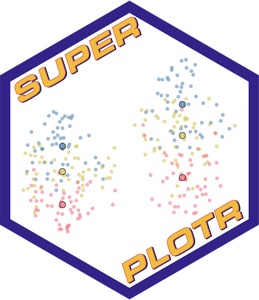

<!-- README.md is generated from README.Rmd. Please edit that file -->

```{r, include = FALSE}
knitr::opts_chunk$set(
  collapse = TRUE,
  comment = "#>",
  fig.path = "man/figures/README-",
  out.width = "100%"
)
```

# SuperPlotR <a href="https://quantixed.github.io/SuperPlotR/"></a>

<!-- badges: start -->
[](https://github.com/quantixed/SuperPlotR/actions/workflows/R-CMD-check.yaml)
[](https://doi.org/10.5281/zenodo.14606751)
<!-- badges: end -->

The goal of SuperPlotR is to allow the user to easily generate SuperPlots in R.

SuperPlots are a way to visualise data in a way that emphasises the experimental
reproducibility.
You can read more about SuperPlots in the
[original paper](https://doi.org/10.1083/jcb.202001064):

Lord, S.J., Velle, K.B., Mullins, R.D. & Fritz-Laylin, L.K. (2020)
**SuperPlots: Communicating reproducibility and variability in cell biology.**
_J. Cell Biol._ 219(6):e202001064

## Installation

You can install the development version of SuperPlotR from [GitHub](https://github.com/) with:

``` {r install, eval = FALSE}
# install.packages("pak")
pak::pak("quantixed/SuperPlotR")
```

## Example

A simple example of how to use SuperPlotR is shown below:

```{r example}
library(SuperPlotR)
superplot(lord_jcb, "Speed", "Treatment", "Replicate", ylab = "Speed (µm/min)")
```

The data used in this example is included in the package and is from the original
paper.

To generate a SuperPlot, you need a data frame that has at least three columns.
These columns are:

1. the variable that is measured in the experiment,
2. the experimental condition,
3. the experimental repeat that the measurement comes from.

The `superplot()` function takes the data frame, the names of these three columns,
and can be customised further with additional arguments.


## Learn more

SuperPlotR can do a lot more. Check out the guides below to help make your plots shine!

- [Getting Started](https://quantixed.github.io/SuperPlotR/articles/SuperPlotR.html)
- [Changing the colours](https://quantixed.github.io/SuperPlotR/articles/colours.html)
- [Getting the sizing right](https://quantixed.github.io/SuperPlotR/articles/sizing.html)
- [Advanced Usage](https://quantixed.github.io/SuperPlotR/articles/advanced.html)
- [Statistical Testing](https://quantixed.github.io/SuperPlotR/articles/stats.html)
- [Faceting a SuperPlot](https://quantixed.github.io/SuperPlotR/articles/facets.html)

There are some things that SuperPlotR can't do and these limitations are here:

- [Limitations to SuperPlotR](https://quantixed.github.io/SuperPlotR/articles/limitations.html)

Bonus tracks:

SuperPlotR can generate a couple of other plot types

- [FlatPlots](https://quantixed.github.io/SuperPlotR/articles/flatplot.html)
- [PiePlots](https://quantixed.github.io/SuperPlotR/articles/pieplot.html)

## More information

My SuperPlot package for IGOR Pro is available
[here](https://github.com/quantixed/SuperPlot)

A popular web-based app for generating SuperPlots, developed by 
[Joachim Goedhart](https://github.com/JoachimGoedhart) is available
[here](https://huygens.science.uva.nl/SuperPlotsOfData/)
