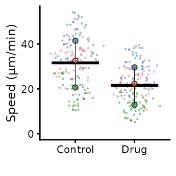

# sizing

## Sizing the SuperPlot

The default setting is to use point sizes of 2 for the data and 3 for
the summary points. The font size is 12. This looks good in the RStudio
viewer, but is not well suited to a figure which is likely to be very
small.

``` r

library(SuperPlotR)
# the default plot
superplot(lord_jcb, "Speed", "Treatment", "Replicate", ylab = "Speed (µm/min)")
```


``` r

# the same plot but with custom sizing
superplot(lord_jcb, "Speed", "Treatment", "Replicate", ylab = "Speed (µm/min)",
          size = c(0.8,1.5), fsize = 9)
```


This does not look great in the viewer, but it will look better in a
figure.

``` r

library(ggplot2)
# the same plot but with custom sizing
superplot(lord_jcb, "Speed", "Treatment", "Replicate",
               ylab = "Speed (µm/min)", size = c(0.8,1.5), fsize = 9)
```



``` r

ggsave("plot.pdf", width = 88, height = 50, units = "mm") # final size
```

Above, we used the same settings for
[`superplot()`](https://quantixed.github.io/SuperPlotR/reference/superplot.md)
but we changed the size of the exported graphic. These settings: font
size of 9, point sizes of 0.8 and 1.5, look good when the plot is at
figure panel size.

This is preferable to using the defaults and exporting at a small size.

``` r

library(ggplot2)
# the same plot but with custom sizing
superplot(lord_jcb, "Speed", "Treatment", "Replicate",
               ylab = "Speed (µm/min)")
```


``` r

ggsave("plot.pdf", width = 88, height = 50, units = "mm") # final size
```

As with everything else in `ggplot2`, the sizing of a plot can be tricky
and usually requires iterative export and tweaking to get the perfect
plot.
